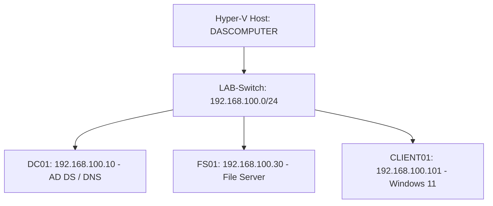

# Windows Server & Active Directory Homelab

## Project Overview

This project documents the implementation of a Windows Server domain environment using Hyper-V.

The objective was to gain hands-on experience in Windows Server administration, Active Directory, networking, file services, Group Policy, and troubleshooting.

## Lab Infrastructure

| Machine | Operating System | IP Address | Role |
|---|---|---|---|
| DC01 | Windows Server 2025 | 192.168.100.10 | Domain Controller, DNS |
| FS01 | Windows Server | 192.168.100.30 | File Server |
| CLIENT01 | Windows 11 | 192.168.100.101 | Domain-joined client |

**Domain:** `ad.heimlabor.test`

**Virtualization:** Microsoft Hyper-V

**Network:** `192.168.100.0/24`

## Implemented Features

### 1. Active Directory Domain Services

- Installed and configured Active Directory Domain Services (AD DS).
- Configured a domain controller.
- Created organizational units, users, and security groups.
- Managed user accounts and group memberships.
- Tested domain authentication using a Windows client.

### 2. DNS and Networking

- Configured DNS for Active Directory.
- Verified DNS name resolution.
- Investigated DNS and connectivity problems.
- Configured virtual networking using Hyper-V.

### 3. File Server Administration

- Configured shared folders using SMB.
- Managed NTFS permissions.
- Assigned access permissions using security groups.
- Tested file access from a domain-joined client.

### 4. Group Policy

- Created and configured Group Policy Objects (GPOs).
- Implemented network drive mapping.
- Tested policy application on a Windows client.

### 5. PowerShell Administration

Practiced administrative commands for:

- Querying Active Directory users.
- Filtering enabled and disabled accounts.
- Managing user accounts.
- Troubleshooting Windows Server services.

## Troubleshooting Experience

During this project, I investigated and resolved issues related to:

- DNS name resolution.
- Domain authentication.
- Network connectivity.
- File share permissions.
- Group Policy application.

## Skills Demonstrated

- Windows Server Administration
- Active Directory Domain Services
- DNS
- Group Policy
- SMB and NTFS Permissions
- PowerShell
- Hyper-V
- Troubleshooting

## Next Steps

- Expand PowerShell automation.
- Implement additional security configurations.
- Explore hybrid identity with Microsoft Entra ID.
- Integrate monitoring and log analysis.

## Conclusion

This homelab provides practical experience in designing, configuring, maintaining, and troubleshooting a Windows Server domain environment.

## Network Architecture

